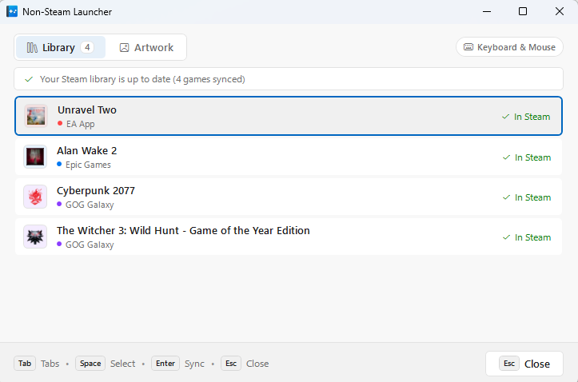

# Non-Steam Launcher 🚀

<p align="center">
  <br>
  <strong>v1.9.0</strong><br>
  <em>El puente perfecto entre launchers de terceros y Steam.</em>
</p>

<p align="center">
  <a href="README.md"><strong>English</strong></a> | 
  <a href="README.es.md"><strong>Español</strong></a>
</p>

## 📸 Captura de la Interfaz

<p align="center">
  
</p>

---

**Non-Steam Launcher** es una utilidad ligera para Windows (.NET 9) que detecta y sincroniza automáticamente tus juegos instalados en plataformas de terceros (**Epic Games Store, EA App, Ubisoft Connect, Battle.net, GOG Galaxy y Xbox / PC Game Pass**) directamente en tu biblioteca de **Steam**, incluyendo carátulas y arte oficial.

Además, resuelve el clásico problema de seguimiento de tiempo de juego en Steam monitoreando el proceso real del juego en lugar del cliente de fondo.

---

## ✨ Características Destacadas (Highlights)

- 🎮 **Compatible con cualquier Joystick o Mando**: Navega y controla toda la interfaz cómodamente desde el sofá con **cualquier mando** (Xbox, PlayStation DualSense / DualShock, Nintendo Switch Pro Controller o mandos genéricos XInput/DirectInput), adaptando los iconos de los botones dinámicamente.
- 🛋️ **Couch Gaming en 1 Clic**: Haz doble clic en `NonSteamLauncher.exe` para escanear e importar todos tus juegos a Steam sin configuraciones manuales.
- 🎨 **Carátulas e Iconos con SteamGridDB**: Descarga automática de covers verticales, banners/heroes, logos e iconos directo a las carpetas de Steam.
- 🖼️ **Diseño Moderno Fluent 2**: Interfaz nativa tipo Windows 11 adaptativa a tema Claro/Oscuro, color de acento del sistema y múltiples idiomas (Español e Inglés).
- 🧠 **Smart Auto-Detect**: Detecta el ejecutable real del juego ignorando lanzadores en segundo plano (`EpicGamesLauncher`, `EADesktop`, `UbisoftConnect`, etc.).
- ⏱️ **Seguimiento Preciso de Tiempo de Juego**: Steam mantiene tu estado "En juego" hasta que cierras el juego real, registrando tus horas correctamente.
- 🛡️ **Seguro y no invasivo**: Respaldo automático de `shortcuts.vdf` antes de modificar y preservación intacta de tus accesos directos existentes.

---

## ⚡ Uso Rápido

### 1. Sincronización Automática (Recomendado)
Simplemente haz doble clic en `NonSteamLauncher.exe` o ejecútalo desde la terminal:

```cmd
NonSteamLauncher.exe
```

#### Opciones útiles de sincronización:
```cmd
# Configurar API Key de SteamGridDB para descargar carátulas automáticamente
NonSteamLauncher.exe --sgdb-key "TU_API_KEY"

# Sincronización en segundo plano sin ventana (modo silencioso)
NonSteamLauncher.exe --silent

# Listar los juegos detectados en consola sin modificar Steam
NonSteamLauncher.exe --list-games

# Sincronizar sin descargar arte/imágenes
NonSteamLauncher.exe --no-artwork
```

---

### 2. Lanzamiento Manual de Juegos (Vía Steam)
También puedes utilizar Non-Steam Launcher como lanzador intermediario dentro de un acceso directo en Steam:

```cmd
NonSteamLauncher.exe "com.epicgames.launcher://apps/Item?action=launch" --close-launcher --disable-overlay
```

---

## 📋 Parámetros de Línea de Comandos

| Parámetro | Alias | Descripción |
|---|---|---|
| `--sync-steam` | `--sync` | Escanea y sincroniza los juegos instalados con Steam (*por defecto si se ejecuta sin argumentos*). |
| `--list-games` | `--scan` | Muestra en consola los juegos detectados sin modificar Steam. |
| `--sgdb-key` | `-k`, `--api-key` | Guarda y utiliza tu API Key de SteamGridDB para descargar arte oficial. |
| `--no-artwork` | `--no-images` | Omite la descarga de carátulas, heroes, logos e iconos. |
| `--silent` | `-q`, `--quiet`, `--no-ui` | Modo silencioso sin ventana de diálogo emergente. |
| `--steam-path` | `--steam` | Ruta personalizada a la instalación de Steam (por defecto auto-detectada). |
| `--dry-run` | | Simula la sincronización sin escribir en disco. |
| `--launch` | `-l` | URI, comando o ejecutable a iniciar y monitorear. |
| `--process` | `-p` | Nombre exacto del proceso a rastrear (omite la autodetección). |
| `--close-launcher`| `-c` | Cierra el cliente de la tienda (Epic, EA, Ubisoft, etc.) al salir del juego. |
| `--disable-overlay`| `-o` | Cierra procesos de overlay invasivos (ej. `EOSOverlayRenderer`). |
| `--sync-delay` | `-d`, `-s` | Segundos a esperar tras salir del juego antes de cerrar el launcher (para guardado en nube). |
| `--help` | `-h`, `/?` | Muestra la ayuda de uso. |

---

## 🛠️ Compilación

Desarrollado en **.NET 9** para Windows x64 en ejecutable único autosuficiente (*Single File*):

```bash
# Ejecutar suite de pruebas
dotnet test NonSteamLauncher.sln

# Publicar binario optimizado
dotnet publish NonSteamLauncher/NonSteamLauncher.csproj -c Release -r win-x64 --self-contained false -p:PublishSingleFile=true
```

---

## 📄 Licencia
Distribuido bajo la Licencia **MIT**. Libre para uso personal y comercial.
