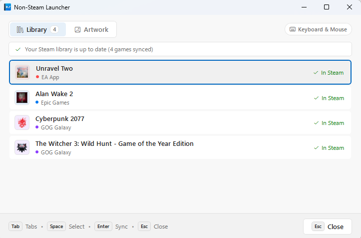

# Non-Steam Launcher 🚀

<p align="center">
  <br>
  <strong>v1.9.0</strong><br>
  <em>The seamless bridge between third-party PC launchers and Steam.</em>
</p>

<p align="center">
  <a href="README.md"><strong>English</strong></a> | 
  <a href="README.es.md"><strong>Español</strong></a>
</p>

## 📸 Interface Preview

<p align="center">
  
</p>

---

## ⚡ Quick Start

### 1. Automatic Sync (Recommended)
Simply double-click `NonSteamLauncher.exe` or run it from the terminal:

```cmd
NonSteamLauncher.exe
```

#### Common Sync Options:
```cmd
# Set your SteamGridDB API key to enable automated artwork downloading
NonSteamLauncher.exe --sgdb-key "YOUR_API_KEY"

# Silent background sync (no UI popup)
NonSteamLauncher.exe --silent

# Preview detected games in terminal without writing to Steam
NonSteamLauncher.exe --list-games

# Sync shortcuts without downloading artwork/images
NonSteamLauncher.exe --no-artwork
```

---

### 2. Manual Game Launch (Via Steam)
You can also use Non-Steam Launcher directly as a wrapper inside Steam shortcuts:

```cmd
NonSteamLauncher.exe "com.epicgames.launcher://apps/Item?action=launch" --close-launcher --disable-overlay
```

---

## 📋 Command-Line Options

| Option | Aliases | Description |
|---|---|---|
| `--sync-steam` | `--sync` | Scans and syncs installed games into Steam (*default when run without arguments*). |
| `--list-games` | `--scan` | Displays detected games in terminal without altering Steam. |
| `--sgdb-key` | `-k`, `--api-key` | Saves and uses your SteamGridDB API key for automatic artwork downloads. |
| `--no-artwork` | `--no-images` | Skips downloading covers, heroes, logos, and icons. |
| `--silent` | `-q`, `--quiet`, `--no-ui` | Runs silently without displaying the completion dialog. |
| `--steam-path` | `--steam` | Custom Steam installation path (auto-detected if omitted). |
| `--dry-run` | | Simulates sync without modifying disk files. |
| `--launch` | `-l` | Launcher URI, command line, or executable path to start and track. |
| `--process` | `-p` | Explicit process name to track (bypasses auto-detection). |
| `--close-launcher`| `-c` | Closes the third-party launcher client when the game exits. |
| `--disable-overlay`| `-o` | Terminates invasive third-party overlays (e.g. `EOSOverlayRenderer`). |
| `--sync-delay` | `-d`, `-s` | Seconds to wait after the game exits before closing launcher (allows cloud sync). |
| `--help` | `-h`, `/?` | Shows usage instructions. |

---

## 🛠️ Building from Source

Built with **.NET 9** for Windows x64 as a single-file executable:

```bash
# Run test suite
dotnet test NonSteamLauncher.sln

# Publish optimized single-file binary
dotnet publish NonSteamLauncher/NonSteamLauncher.csproj -c Release -r win-x64 --self-contained false -p:PublishSingleFile=true
```

---

## 📄 License
Released under the **MIT License**. Free for personal and commercial use.
